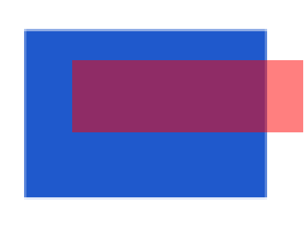
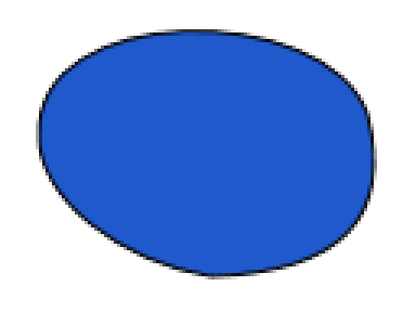
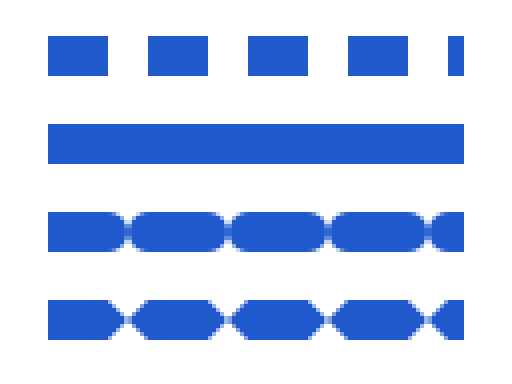
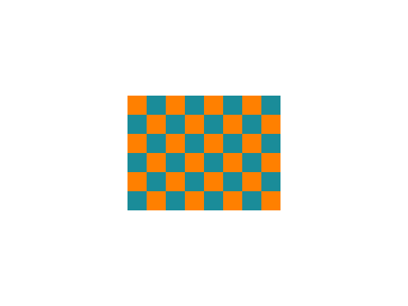
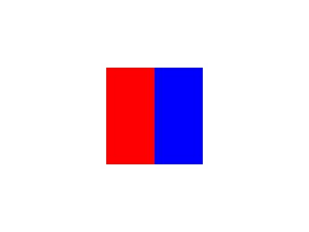
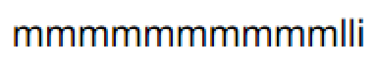
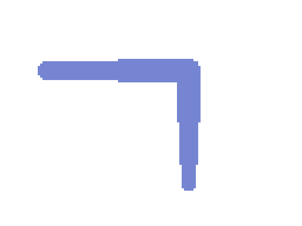
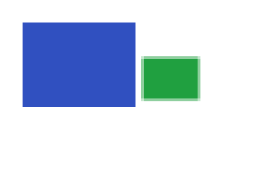
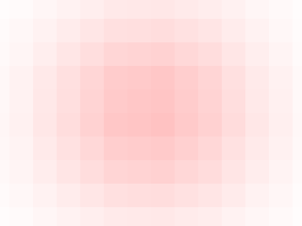

# OpenD2D

OpenD2D is an open source reimplementation of Direct2D, along with the parts of DirectWrite, WIC, and DXGI it needs. It draws
the same pixels as native Direct2D on Windows' WARP software device, and it exposes the same COM
interfaces and DLL exports, so applications can use it as a drop-in replacement. It runs on Windows,
Linux, macOS, FreeBSD, and in the browser.

> [!WARNING]
> **This is a public demo beta (0.1.0-beta.1). Full parity with Direct2D is not complete yet.**
> 27 of 6,159 suite scenes and about 390 of 20,600 fuzz scenes still differ from native Windows, and
> some API methods are not implemented. Don't rely on it matching Windows in every case yet.

Not at parity yet:

- **Text:** some color emoji (rotated, skewed or overlapping COLR glyphs), hinted text in some fonts
  and in non-Latin fallback fonts, synthetic bold in GDI-measured layouts, upright emoji clusters in
  vertical text, Arabic kashida justification, and Thai dictionary line breaking (off by default).
- **Bitmaps:** anisotropic and high-quality cubic sampling in some rotated or fractional-offset draws,
  and some image draws that share Direct2D's internal atlas.
- **Effects:** a few of the 64 built-in effects are not exact on every input, including LookupTable3D
  with 8-bit tables or extents that aren't powers of two.
- **Float targets:** reading back a high-precision float (R16/R32) target is not supported.
- **Missing methods:** `CreateSharedBitmap`, `CreateCompatibleRenderTarget`, `CreateLayer`,
  `CreateMesh`, `GetGradientMeshWorldBounds`, `CreateSvgGlyphStyle`, `GetColorBitmapGlyphImage`,
  `GetSvgGlyphImage`, `GetRegisteredEffects`, `GetEffectProperties` and `ID2D1PathGeometry::Stream`.
- **Off Windows:** the native Linux, macOS and FreeBSD libraries cover rendering and read-back with
  geometry and solid brushes; text, effects and WIC saving go through the Windows DLLs under Wine for
  now.
- **GPU:** the GPU backend and shader translation are experimental and not covered by the parity
  results.

Details in [docs/gaps.md](docs/gaps.md).

> This software was largely built with the help of Claude. It was built for experimental and personal use only. Please use with caution.

<hr width=50>

## Conformance

Every test scene is compared byte for byte with a capture from native Direct2D 10.0.26100.8875 on
WARP (Windows 11 LTSC 26100). Pixels, return codes, and query results must all match. The native
captures themselves are not part of this repository; the differential fuzzer that generates the
fuzz scenes is (`tools/fuzz` and `harness`).

| Measure | Result |
| --- | --- |
| Suite scenes byte-exact | 6132 of 6159 |
| Fuzz scenes byte-exact | 98.1% (390 of ~20,600 differ) |
| Same output on x86-64, wasm32, aarch64, and Windows under Wine | yes |
| C, C++, and Rust examples byte-exact through the COM ABI | yes |

<hr width=50>

## Showcase

Each scene rendered by native Direct2D and by OpenD2D, with an amplified diff. Black means identical.
`scripts/showcase.sh` regenerates the images and this table.

<!-- showcase:start -->
| Scene | Native | OpenD2D | Diff | Result |
| --- | --- | --- | --- | --- |
| Antialiased rectangles at fractional coordinates |  |  |  | identical |
| Bézier curves and arcs |  |  |  | identical |
| Dashed strokes with caps |  |  |  | identical |
| Gamma-correct linear gradient |  |  |  | identical |
| Bitmap scaled up with the cubic filter |  |  |  | identical |
| Layer with an opacity mask |  |  |  | identical |
| DrawImage compositing |  |  |  | identical |
| Custom pixel shader effect |  |  |  | identical |
| ClearType text: mmmmmmmmmmlli |  |  |  | identical |
| Combined and simplified geometry |  |  |  | identical |
| Ink stroke |  |  |  | identical |
| SVG document |  |  |  | identical |
| Bitmap scaled up with the high-quality cubic filter |  |  |  | identical |
| Shadow effect |  |  |  | identical |
<!-- showcase:end -->

<hr width=50>

## Scope

Implemented:

- Direct2D 1.0 to 1.3 drawing: geometries, brushes, layers, clips, the 64 built-in effects, sprite
  batches, ink, gradient meshes, command lists, SVG, and metafile playback
- DirectWrite rendering, layout, and shaping, including ClearType and color fonts
- the WIC codecs and transforms Direct2D uses

Drawing straight into a window, a GDI device context, or a printer needs Windows, because those
objects only exist there. Everywhere else, draw into a bitmap and show it with the platform's own
windowing code. The remaining gaps are listed in
[docs/gaps.md](docs/gaps.md).

<hr width=50>

## Performance

Minimum wall time over repeated renders of photo-size scenes, native (x86-64) and in the browser
(wasm32, `simd128`). Every optimisation is output-identical. Full table and method in
[docs/perf.md](docs/perf.md); refresh with `scripts/perf-bench.sh`.

| scene (size)         | native (ms) | wasm (ms) |
|----------------------|------------:|----------:|
| image-up (1920×1080) |         582 |      1371 |
| fill-4k (3840×2160)  |          51 |       129 |
| gradient-linear-4k   |         359 |       711 |
| blur-4k (3840×2160)  |         283 |         — |

<hr width=50>

## Platforms

| Platform | What you get |
| --- | --- |
| Windows | d2d1.dll, dwrite.dll, and windowscodecs.dll |
| Wine | the same DLLs, loaded with WINEDLLOVERRIDES |
| Linux, macOS, and FreeBSD | libd2d1, libdwrite, and libwindowscodecs |
| Rust | the d2d crate |
| Browser | the d2d crate built for wasm32 |

<hr width=50>

## Quick start

### Windows

```sh
cargo build --release -p d2d-ffi -p dwrite-ffi -p wic-ffi --target x86_64-pc-windows-gnu
```

Put d2d1.dll and dwrite.dll next to the application's .exe. Windows loads them before the system
copies.

windowscodecs.dll is found through the registry, so a local copy is ignored by CoCreateInstance. To
use OpenD2D's WIC, call its exported WICCreateImagingFactory_Proxy, or use a registration-free COM
manifest. Apps that only need Direct2D and DirectWrite can keep the system copy.

### Wine

```sh
cp d2d1.dll dwrite.dll "$WINEPREFIX/drive_c/path/to/app/"
cp windowscodecs.dll "$WINEPREFIX/drive_c/windows/system32/"
WINEDLLOVERRIDES="d2d1,dwrite,windowscodecs=n" wine app.exe
```

### Linux, macOS, and FreeBSD

The libraries export the same COM interfaces and functions as on Windows, so code written against
d2d1.h builds unchanged.

```sh
cargo build --release -p d2d-ffi
cc app.c -L target/release -ld2d1
```

### Rust

```toml
[dependencies]
d2d = { git = "https://github.com/daijro/opend2d" }
```

The d2d crate is the renderer itself, with a safe Rust API and no COM. It builds for every target,
including wasm32.

### Browser

```sh
cargo build --release -p d2d --target wasm32-unknown-unknown
```

The renderer runs in the browser with no GPU. Call it from JavaScript through wasm-bindgen.

## Examples

crates/d2d-ffi/examples has the same small program in C, C++, and Rust. Each one draws a scene through
the standard API. With a native capture of the scene available (`D2D_SUITE` pointing at a conformance
capture set), the script also checks the result against native byte for byte.

```sh
sh crates/d2d-ffi/examples/run-examples.sh
```

<hr width=50>

## Repository layout

| Path | Contents |
| --- | --- |
| crates/d2d | the renderer |
| crates/d2d-ffi | d2d1.dll and libd2d1 |
| crates/dwrite-ffi | dwrite.dll and libdwrite |
| crates/wic-ffi | windowscodecs.dll and libwindowscodecs |
| crates/d2d-types | shared types and the COM interface list |
| crates/windows-shim, crates/windows-core-shim | Windows bindings for non-Windows builds |
| crates/d2d-wgpu, crates/d2d-shader | optional GPU backend and shader translation |
| harness | the reference renderer for Windows and the differential fuzzer |
| conformance | the conformance test runners |
| web | the browser test runner |
| docs | documentation |

<hr width=50>

## License

OpenD2D is licensed under the GNU General Public License, version 3 or later (see [LICENSE](LICENSE)).
Its Windows API bindings are generated from Microsoft's MIT-licensed Win32 metadata, and parts of the
geometry code are ported from Microsoft's MIT-licensed WPF sources. Those and the other
third-party components are listed in [THIRD-PARTY-NOTICES](THIRD-PARTY-NOTICES).
