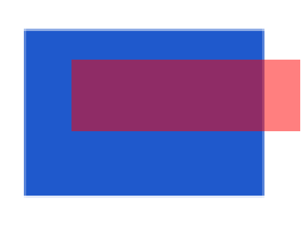
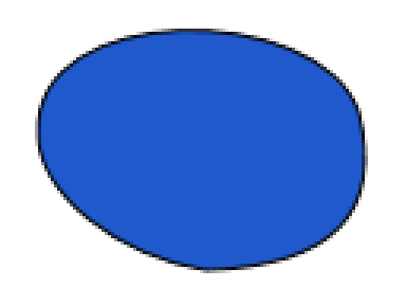
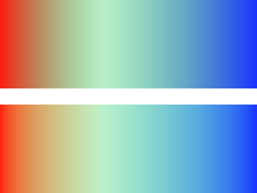
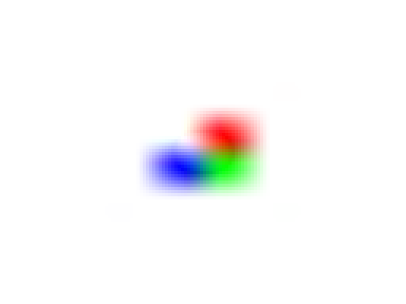
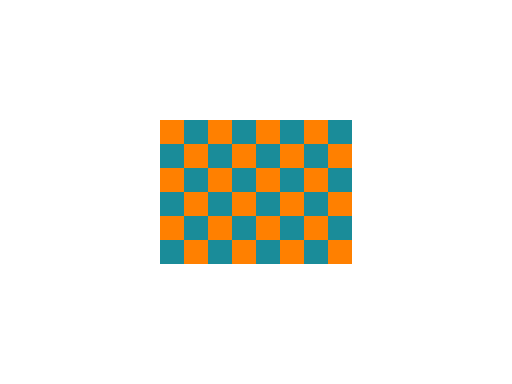
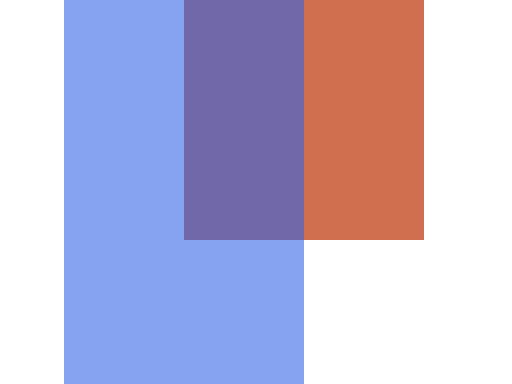
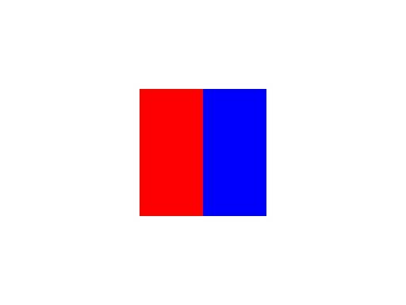
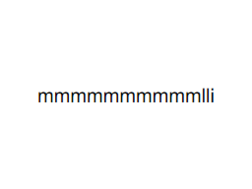
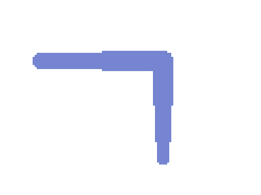

# OpenD2D

OpenD2D is an open source reimplementation of Direct2D, together with the parts of DirectWrite, WIC
and DXGI that Direct2D needs. It aims to draw exactly the same pixels as Direct2D does on Windows'
WARP software renderer, and it exposes the same COM interfaces and DLL exports, so an application
can use it in place of the Windows libraries. It runs on Windows, Linux, macOS, FreeBSD and in the
browser.

*This software was largely built with the help of Claude. Please use with caution!*

> [!WARNING]
> **This is a public demo beta (0.1.0-beta.1). Full parity with Direct2D is not complete yet.**
> 27 of 6,159 test scenes and about 390 of 20,600 randomly generated scenes still differ from
> Windows, and some API methods are not implemented yet. Don't rely on it matching Windows in every
> case.

<details>
<summary>Not at parity yet</summary>

- Text: some color emoji (rotated, skewed or overlapping COLR glyphs), hinted text in some fonts and
  in fallback fonts for non-Latin scripts, synthetic bold in GDI-measured layouts, upright emoji in
  vertical text, Arabic kashida justification, and Thai dictionary line breaking (off by default).
- Bitmaps: anisotropic and high-quality cubic sampling in some rotated or fractionally placed draws,
  and some image draws that share Direct2D's internal texture atlas.
- Effects: a few of the 64 built-in effects are not exact on every input, for example LookupTable3D
  with 8-bit tables or with sizes that aren't powers of two.
- Float targets: reading back a high-precision float (R16 or R32) target is not supported.
- Missing methods: CreateSharedBitmap, CreateCompatibleRenderTarget, CreateLayer, CreateMesh,
  GetGradientMeshWorldBounds, CreateSvgGlyphStyle, GetColorBitmapGlyphImage, GetSvgGlyphImage,
  GetRegisteredEffects, GetEffectProperties and ID2D1PathGeometry::Stream.
- Off Windows: the Linux, macOS and FreeBSD libraries have the same COM API as the Windows DLLs,
  except for methods that need a window, a GDI device context, DXGI or a printer.
- Partly implemented: GDI metafile playback covers only basic records, printing produces whole-page
  raster output, DXGI surfaces are single-plane BGRA (no multi-plane YUV), and Widen does not match
  yet for round joins, round caps or square caps.
- GPU: the GPU backend and shader translation are experimental and not covered by these results.

[docs/gaps.md](docs/gaps.md) shows examples of each difference next to Windows' output.

</details>

## How close it is

Every test draws a scene with OpenD2D and compares the result, byte for byte, with what Direct2D
10.0.26100.8875 produced for the same scene on Windows 11 (LTSC 26100, WARP). Pixels, return codes
and query results all have to match. On top of the hand-written test scenes, a fuzzer generates
random scenes and compares those too. The Windows captures themselves are not in this repository;
the fuzzer is, in `tools/fuzz` and `harness`. [docs/conformance.md](docs/conformance.md) explains
how the checks work.

| | Result |
| --- | --- |
| Test scenes that match exactly | 6132 of 6159 |
| Random fuzz scenes that match exactly | 98.1% (390 of about 20,600 differ) |
| Same output on x86-64, wasm32, aarch64 and under Wine | yes |
| C, C++ and Rust examples match through the COM interface | yes |

## Showcase

Each row shows one scene drawn by Direct2D on Windows and by OpenD2D, and the difference between
the two. The difference is amplified so that even a one-step change in a color channel is visible;
an all-black image means the two are identical. `scripts/showcase.sh` regenerates the images and
this table.

<!-- showcase:start -->
| Scene | Direct2D | OpenD2D | Difference | Result |
| --- | --- | --- | --- | --- |
| Antialiased rectangles at fractional coordinates |  |  |  | identical |
| Bézier curves and arcs |  |  |  | identical |
| Dashed strokes with caps |  |  |  | identical |
| Gamma-correct linear gradient |  |  |  | identical |
| Bitmap scaled up with the cubic filter |  |  |  | identical |
| Layer with an opacity mask |  |  |  | identical |
| DrawImage compositing |  |  |  | identical |
| Custom pixel shader effect |  |  |  | identical |
| ClearType text: mmmmmmmmmmlli |  |  |  | identical |
| Combined and simplified geometry |  |  |  | identical |
| Ink stroke |  |  |  | identical |
| SVG document |  |  |  | identical |
| Bitmap scaled up with the high-quality cubic filter |  |  |  | identical |
| Shadow effect |  |  |  | identical |
<!-- showcase:end -->

## What it covers

OpenD2D implements Direct2D 1.0 to 1.3 drawing (geometries, brushes, layers, clips, the 64 built-in
effects, sprite batches, ink, gradient meshes, command lists, SVG and metafile playback), DirectWrite
text rendering, layout and shaping including ClearType and color fonts, and the WIC codecs and
transforms Direct2D uses.

Drawing directly into a window, a GDI device context or a printer only works on Windows, because
those objects only exist there. On other systems you draw into a bitmap and display it with the
platform's own windowing code. [docs/api.md](docs/api.md) lists coverage interface by interface.

## Performance

These are OpenD2D's own render times. The first column is OpenD2D compiled to native x86-64 code,
the second is the same code compiled to WebAssembly (with SIMD) and run in Node. There is no
Direct2D column: Direct2D only runs on Windows, and these were measured on Linux. Each figure is the
fastest of several runs. Optimisations never change the output. [docs/perf.md](docs/perf.md) has
the full table and how to reproduce it.

| Scene (size) | OpenD2D, x86-64 (ms) | OpenD2D, WebAssembly (ms) |
| --- | ---: | ---: |
| Image scaled up (1920×1080) | 582 | 1371 |
| Fill (3840×2160) | 51 | 129 |
| Linear gradient (3840×2160) | 359 | 711 |
| Blur (3840×2160) | 283 | not measured |

## Platforms

| Platform | What you get |
| --- | --- |
| Windows | d2d1.dll, dwrite.dll and windowscodecs.dll |
| Wine | the same DLLs, loaded with WINEDLLOVERRIDES |
| Linux, macOS and FreeBSD | libd2d1, libdwrite and libwindowscodecs |
| Rust | the d2d crate |
| Browser | the d2d crate built for wasm32 |

## Getting started

### Windows

```sh
cargo build --release -p d2d-ffi -p dwrite-ffi -p wic-ffi --target x86_64-pc-windows-gnu
```

Put d2d1.dll and dwrite.dll next to the application's .exe. Windows loads them before its own copies.

Windows finds windowscodecs.dll through the registry, so CoCreateInstance ignores a local copy. To
use OpenD2D's WIC, call its exported WICCreateImagingFactory_Proxy, or use a registration-free COM
manifest. Applications that only need Direct2D and DirectWrite can keep the system copy.

### Wine

```sh
cp d2d1.dll dwrite.dll "$WINEPREFIX/drive_c/path/to/app/"
cp windowscodecs.dll "$WINEPREFIX/drive_c/windows/system32/"
WINEDLLOVERRIDES="d2d1,dwrite,windowscodecs=n" wine app.exe
```

### Linux, macOS and FreeBSD

The libraries export the same COM interfaces and functions as on Windows, so code written against
d2d1.h builds unchanged.

```sh
cargo build --release -p d2d-ffi
cc app.c -L target/release -ld2d1
```

### Rust

```toml
[dependencies]
d2d = { git = "https://github.com/daijro/opend2d" }
```

The d2d crate is the renderer itself, with a safe Rust API and no COM. It builds for every target,
including wasm32.

### Browser

```sh
cargo build --release -p d2d --target wasm32-unknown-unknown
```

The renderer runs in the browser without a GPU. Call it from JavaScript through wasm-bindgen.

## Examples

`crates/d2d-ffi/examples` has the same small program in C, C++ and Rust. Each draws a scene through
the standard API. If you have the Windows captures and point `D2D_SUITE` at them, the script also
checks the result against Windows.

```sh
sh crates/d2d-ffi/examples/run-examples.sh
```

## Repository layout

| Path | Contents |
| --- | --- |
| crates/d2d | the renderer |
| crates/d2d-ffi | d2d1.dll and libd2d1 |
| crates/dwrite-ffi | dwrite.dll and libdwrite |
| crates/wic-ffi | windowscodecs.dll and libwindowscodecs |
| crates/d2d-types | shared types and the COM interface list |
| crates/windows-shim, crates/windows-core-shim | Windows bindings for non-Windows builds |
| crates/d2d-wgpu, crates/d2d-shader | the experimental GPU backend and shader translation |
| harness | the Windows reference renderer and the fuzzer |
| conformance | the conformance test runners |
| web | the browser test runner |
| docs | documentation |

## License

OpenD2D is licensed under the GNU General Public License, version 3 or later (see
[LICENSE](LICENSE)). Its Windows API bindings are generated from Microsoft's MIT-licensed Win32
metadata, and parts of the geometry code are ported from Microsoft's MIT-licensed WPF sources. These
and the other third-party components are listed in [THIRD-PARTY-NOTICES](THIRD-PARTY-NOTICES).
