# Known gaps

This page lists where OpenD2D does not yet match Direct2D exactly, and what it does not implement
yet. Some methods fail on purpose because Direct2D fails in the same way; those are listed
separately under [deliberate native-matching rejections](api.md#deliberate-native-matching-rejections).

The test results are the real measure: 6132 of the 6159 test scenes match Direct2D exactly (7 are
skipped and 20 do not match yet), and so do 98.1% of about 20,600 randomly generated scenes. This
page describes the rest.

## What the differences look like

Each row is one example of an open difference. The first two images are the same scene drawn by
Direct2D on Windows and by OpenD2D in this release, cropped to the area where they differ. The third
image is the difference between them, amplified 64 times so that even a one-step change in a color
channel shows up; black means the pixels are identical. The last column counts the pixels that
differ and gives the largest difference in any one channel, out of 255.

| Area | Direct2D | OpenD2D | Difference | Pixels that differ |
| --- | --- | --- | --- | --- |
| Color emoji in a turned group (COLR) | 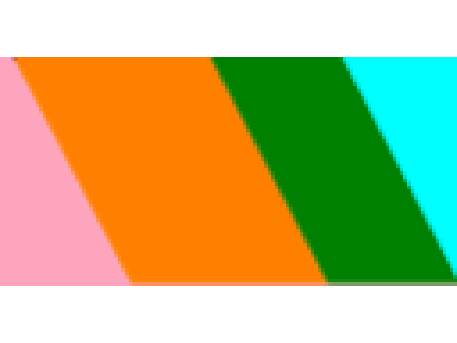 |  | 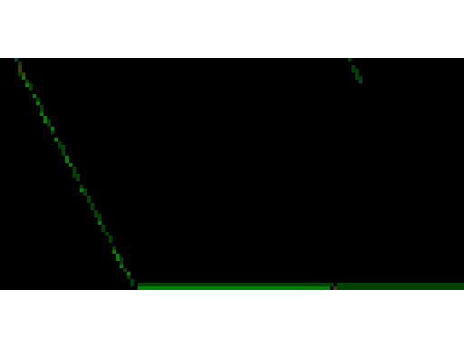 | 256 (largest error 1/255) |
| Hinted italic text |  |  | 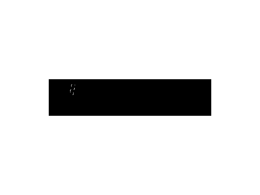 | 18 (largest error 21/255) |
| Synthetic bold in a GDI-measured run | 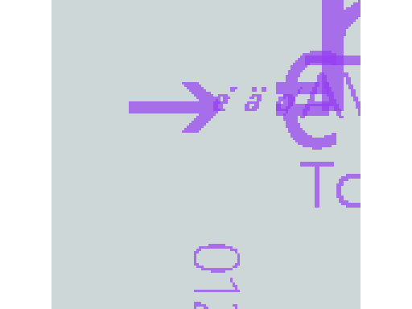 | 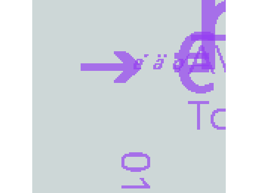 | 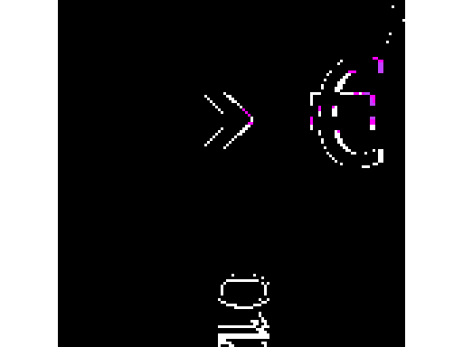 | 317 (largest error 154/255) |
| Upright emoji in vertical text | 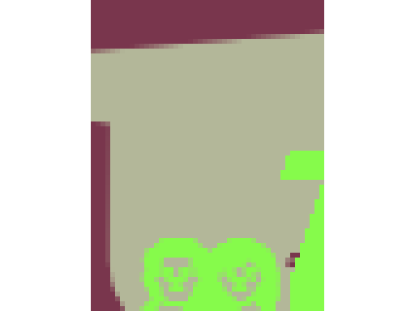 | 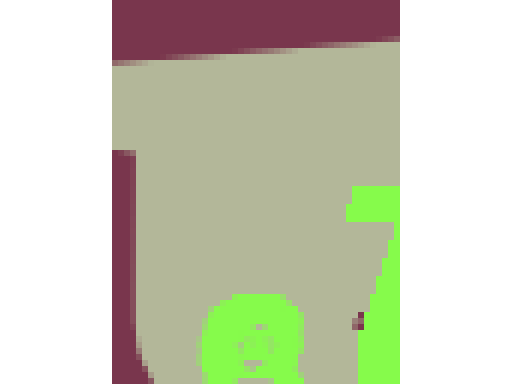 | 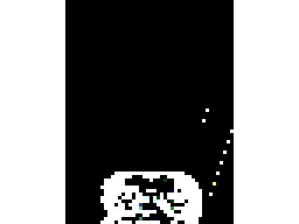 | 299 (largest error 197/255) |
| Bitmap brush with anisotropic sampling | 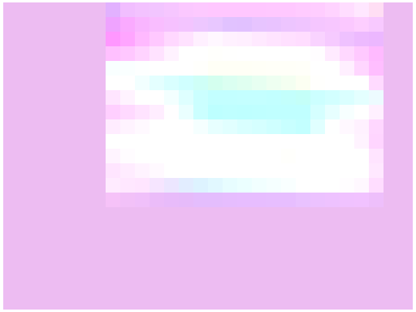 |  | 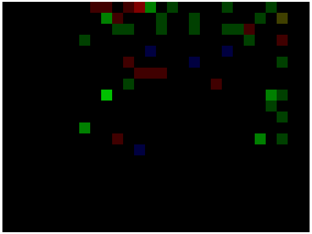 | 104 (largest error 1/255) |
| Bitmap with high-quality cubic sampling | 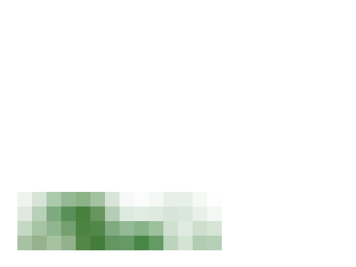 | 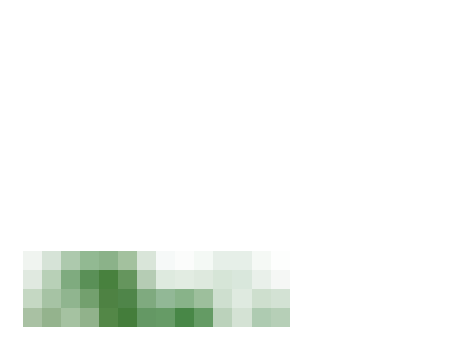 | 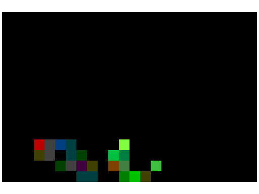 | 23 (largest error 1/255) |
| Two image draws sharing Direct2D's atlas | 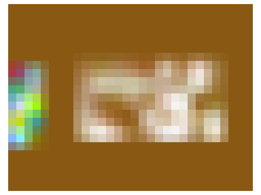 |  | 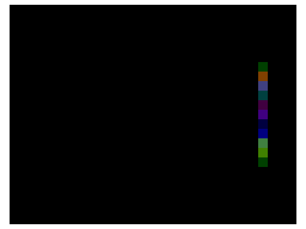 | 12 (largest error 12/255) |
| LookupTable3D with an 8-bit table | 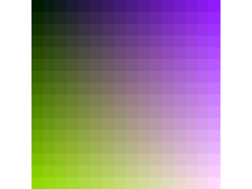 | 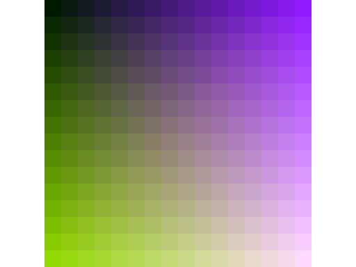 | 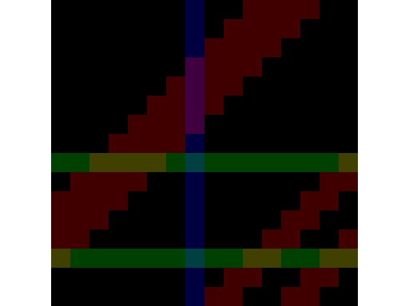 | 104 (largest error 1/255) |

## Text

Most text matches Direct2D exactly. The open cases are some color emoji (COLR glyphs that are
rotated, skewed or overlap each other), hinted text in some fonts and in fallback fonts for
non-Latin scripts, synthetic bold in layouts measured in GDI mode, upright emoji in vertical text,
Arabic justification with kashida, and Thai line breaking. Thai line breaking needs a word
dictionary that OpenD2D cannot ship, so it is off by default.

For fallback fonts the difference is in where hinting places the glyphs. ClearType filtering and
glyph coverage already match exactly, and the same scenes differ by the same pixels whether you call
the Rust renderer directly or go through the DLLs, so this is not a problem in the DLL layer.

## Bitmaps

Bitmaps drawn with anisotropic or high-quality cubic sampling can be off by one step in a color
channel when the bitmap is rotated or placed at a fractional position. Direct2D also packs some
intermediate images into a shared texture atlas, and a few draws that depend on that packing don't
match yet.

## Effects and float targets

All 64 built-in effects are implemented, but not every one matches on every input yet. One example
is LookupTable3D with 8-bit tables or with sizes that aren't powers of two. Some paths for
high-precision float targets (the R16 and R32 formats) are also still being matched.

Reading back a float target with CopyFromBitmap or Map is not supported yet. Reading back an ordinary
8-bit-per-channel BGRA or RGBA target works, including the usual offscreen pattern: render into a bitmap created
with D2D1_BITMAP_OPTIONS_TARGET, copy it into a staging bitmap created with CPU_READ and
CANNOT_DRAW, then map the staging bitmap.

## Path geometry

ID2D1PathGeometry1::ComputePointAndSegmentAtLength matches Direct2D for lines, quadratic and cubic
curves. Arcs don't match yet: Direct2D splits them into a different number of segments.

## Partly implemented

GDI metafile playback (DrawGdiMetafile) handles only basic records, because Direct2D passes full EMF
playback to a separate Windows component that OpenD2D doesn't reproduce yet. Printing through
ID2D1PrintControl produces whole-page raster output rather than vector content. DXGI surfaces and
image sources are single-plane BGRA, without multi-plane YUV. ID2D1Geometry::Widen matches Direct2D
for rectangles and for strokes with flat caps and miter or bevel joins, but not yet for round joins,
round caps or square caps.

## Methods that are not implemented

Direct2D implements these, and OpenD2D does not yet:

- ID2D1RenderTarget::CreateSharedBitmap, a bitmap that shares a DXGI, WIC or memory handle.
- ID2D1RenderTarget::CreateCompatibleRenderTarget, an offscreen bitmap render target.
- ID2D1RenderTarget::CreateLayer, an explicit layer object. Layered drawing still works, because
  PushLayer's parameters are applied directly; only the layer object is missing.
- ID2D1RenderTarget::CreateMesh, the mesh object used by FillMesh.
- ID2D1DeviceContext::GetGradientMeshWorldBounds.
- CreateSvgGlyphStyle, GetColorBitmapGlyphImage and GetSvgGlyphImage, which return images of color
  and SVG glyphs (Direct2D 1.3).
- ID2D1Factory1::GetRegisteredEffects and GetEffectProperties, which list the registered effects.
- ID2D1PathGeometry::Stream, which replays a stored path into a geometry sink.

Some methods need an operating system surface (a window, a DXGI surface, a GDI device context or an
XPS print job), so they only work on Windows and under Wine: CreateHwndRenderTarget,
CreateDxgiSurfaceRenderTarget, CreateDCRenderTarget, CreatePrintControl,
CreateBitmapFromDxgiSurface and CreateImageSourceFromDxgi. The Linux and macOS library returns
E_NOTIMPL for them.

## The Linux, macOS and FreeBSD libraries

OpenD2D builds the same COM implementation for every platform. On Linux, macOS and FreeBSD,
libd2d1, libdwrite and libwindowscodecs offer the same interfaces as the Windows DLLs, including
text, effects and WIC, and nothing from Microsoft is needed. The only methods missing there are the
ones that need a window, a GDI device context, a DXGI surface or a printer, listed above.

## Platform builds

`scripts/package.sh` builds and checks every target the local toolchain can link. On the current
build machine that is x86_64-pc-windows-gnu and x86_64-unknown-linux-gnu, plus the renderer for
wasm32. The other targets (32-bit and ARM Windows, ARM Linux, macOS and FreeBSD) compile with cargo
check, but need their own linker or SDK to produce a library. Output is already proven identical on
every target the build machine can run, with `scripts/conformance.sh parity`.

## Not covered

The GPU backend (`crates/d2d-wgpu`) and the translation of custom pixel and compute shaders
(`crates/d2d-shader`) are experimental. The CPU renderer is the reference, and the parity results
above apply to it only.
